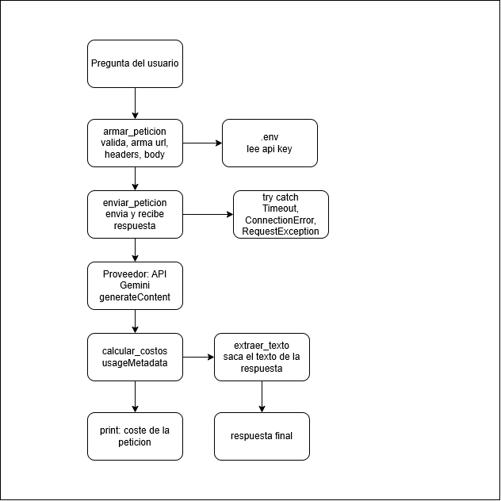

# Decisión de arquitectura: elección de modelo

## Modelo elegido

**`gemini-3.5-flash-lite`**, para la funcionalidad principal de la miniaplicación.

## Diagrama de arquitectura

El flujo completo va desde la pregunta del usuario hasta la respuesta final, pasando por `validar_pregunta`, `armar_peticion` (que incorpora el modelo a la URL de `generateContent`, con la credencial `GEMINI_API_KEY` leída desde `.env`), `enviar_peticion` (con el manejo de errores de red, timeouts y HTTP en `try/except`), `calcular_costos` (que calcula el costo a partir de `usageMetadata`) y `extraer_texto`. Cambiar de modelo no cambia la arquitectura, solo ese parámetro. El diagrama completo está en `docs/diagrama_arquitectura.png`.

## Comparación de candidatos

| Criterio | `gemini-3.1-flash-lite` | `gemini-3.5-flash-lite` | `gemini-3.8-flash` |
|---|---|---|---|
| Costo por 1000 tokens de entrada | 0,00025 USD | 0,00030 USD | 0,00075 USD |
| Costo por 1000 tokens de salida | 0,00150 USD | 0,00250 USD | 0,00375 USD |
| Latencia promedio observada | 5,43 segundos | 2,56 segundos | 27,00 segundos |
| Calidad de respuesta para el caso | Regular: omite o fusiona criterios y falla en el beneficio; 5 de 9 consultas con error 503 | Buena: encuentra los 6 criterios en todas las respuestas, falla en el beneficio; sin errores | Muy buena: acierta rol, objetivo y beneficio; 4 de 9 consultas con timeout o error 503 |
| Fecha de medición | 2026-10-20 | 2026-10-20 | 2026-10-20 |

## Justificación

Para esta miniaplicación, un modelo que omite criterios de aceptación no sirve, sea cual sea su precio, así que el criterio que más pesó fue la calidad como requisito mínimo y, entre los modelos que lo cumplen, el costo. `gemini-3.5-flash-lite` encontró los seis criterios en todas sus respuestas, fue el único sin errores del proveedor y el más rápido, y cada consulta cuesta unos 0,0011 USD, ocho veces menos que con `gemini-3.8-flash`. Su error al clasificar el beneficio se acepta por ahora porque no afecta a los criterios, que es lo esencial.

## Alternativa descartada y por qué

Se descartó **`gemini-3.8-flash`**. Aunque ofrece la mejor calidad y clasifica bien el beneficio, esa diferencia no justifica pagar unas ocho veces más por consulta ni esperar unas diez veces más por una respuesta (llegó a 48 segundos), y su consumo variable de tokens de razonamiento hace el costo difícil de prever. `gemini-3.1-flash-lite` también quedó fuera: es el más barato, pero falló en más de la mitad de las consultas y fue el que más criterios omitió.
